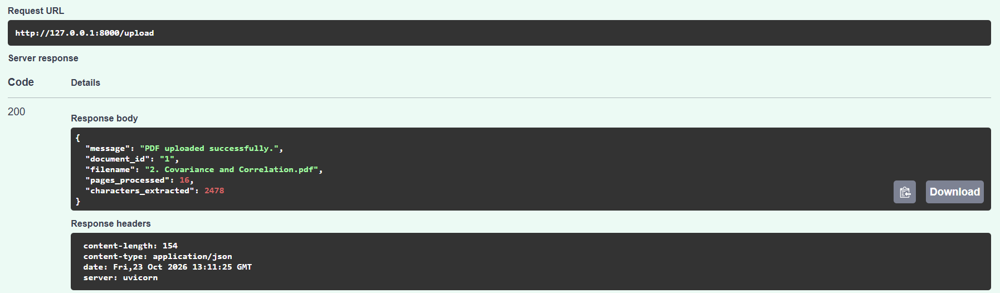
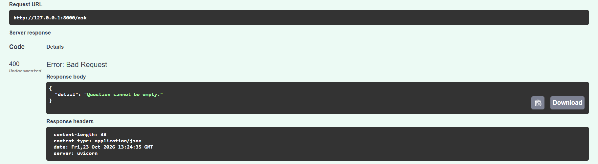
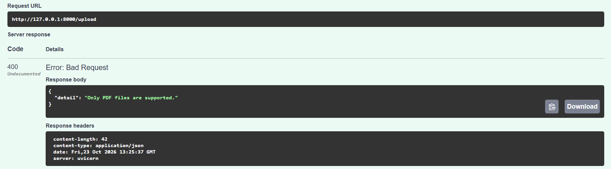
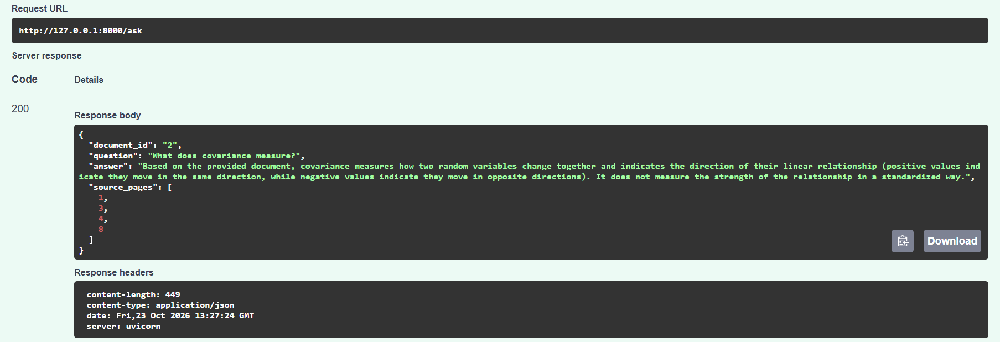
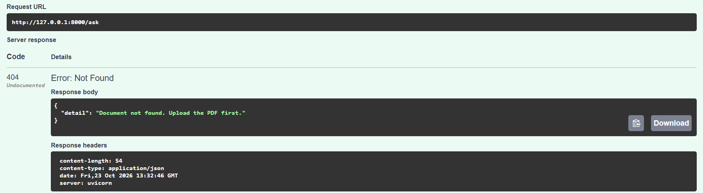
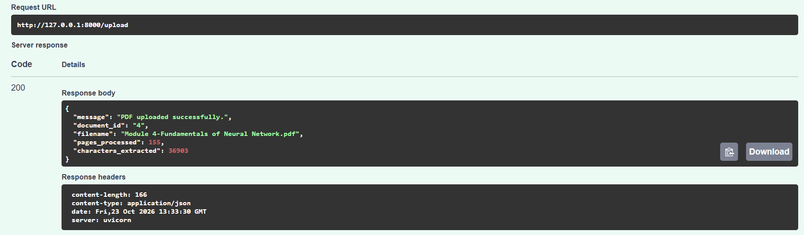
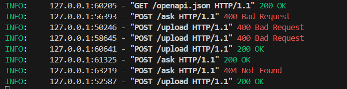

# RAG API Testing Report

## 1. Objective

This testing activity checked the PDF Question Answering RAG API under normal use and selected invalid-input conditions. Testing was performed through FastAPI Swagger UI at `http://127.0.0.1:8000/docs`.

## 2. Test Environment

- **Application:** FastAPI PDF Question Answering RAG API
- **PDF text extraction:** PyMuPDF
- **Answer generation:** Gemini API
- **Testing interface:** FastAPI Swagger UI
- **Server:** Uvicorn
- **Example document:** `2. Covariance and Correlation.pdf`

## 3. Test Cases and Observed Results

| ID | Test scenario | Observed status | Observed result | Assessment |
|---|---|---:|---|---|
| T01 | Upload a valid PDF | 200 OK | `2. Covariance and Correlation.pdf` was accepted as document ID `1`; 16 pages and 2,478 characters were reported. | Passed |
| T02 | Submit an empty/whitespace-only question | 400 Bad Request | Response: `Question cannot be empty.` | Passed |
| T03 | Upload an unsupported file type | 400 Bad Request | Response: `Only PDF files are supported.` | Passed |
| T04 | Upload a PDF with no extractable text | 400 Bad Request | Response: `No extractable text found in this PDF.` This verifies handling of a PDF without extractable text; the screenshot does not independently establish that a zero-byte file was tested. | Passed for this scenario |
| T05 | Ask a question about covariance | 200 OK | The answer explained that covariance measures how two random variables change together and indicates the direction of their relationship. Returned source pages: 1, 3, 4, and 8. | Passed for this example; source relevance needs further review |
| T06 | Ask using an unavailable document ID | 404 Not Found | Response: `Document not found. Upload the PDF first.` | Passed |
| T07 | Upload a large PDF | 200 OK | `Module 4-Fundamentals of Neural Network.pdf` was accepted; 155 pages and 36,903 extracted characters were reported. | Passed for this tested file |

The captured Uvicorn logs also show the corresponding successful and error responses for the requests visible in the screenshot.

## 4. Screenshot Evidence

The screenshots are in the accompanying `RAG_API_Testing_Assets` folder. Keep that folder beside this Markdown file for the relative image links to work.

### T01 — Successful PDF upload

### T02 — Empty question rejected

### T03 — Unsupported file rejected

### T04 — PDF without extractable text rejected

### T05 — Question answered

### T06 — Unknown document rejected

### T07 — Large PDF upload

### Supplementary — Server request logs

## 5. Summary

The captured results show successful uploads of the tested PDFs, a successful answer to the covariance question, and appropriate rejection of an empty question, unsupported file type, PDF without extractable text, and unavailable document ID. A 155-page PDF was also accepted and processed.

These results demonstrate basic endpoint behavior for the cases shown. They do not prove reliability for all document types or sizes, broad answer accuracy, or production readiness. The screenshots do not independently verify a zero-byte upload test or a question about the correlation coefficient range, so those outcomes are not claimed as verified.
