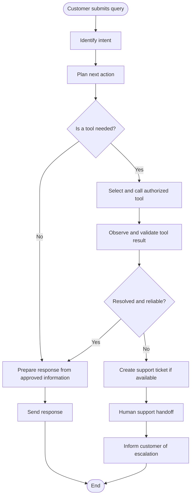
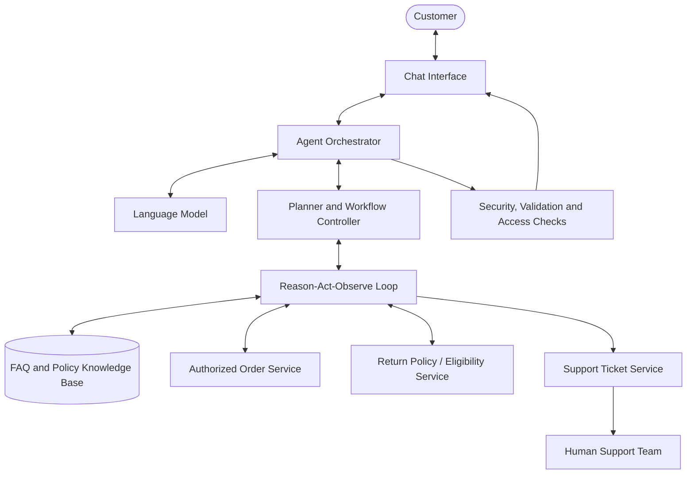

# AI Agent Planning and Design Document

### Customer Support AI Agent for ShopEase (Fictional E-Commerce Company)
**Linkific AI/ML Internship** | Day 18 | 24 October 2026 | **Status:** Design/planning stage

---

## 1. Project Title

**Customer Support AI Agent for ShopEase**

---

## 2. Objective

Design an AI agent that assists customers with common support requests, including frequently asked questions, order-status enquiries, return-policy questions, and support-ticket creation. The agent should use authorized information sources, provide accurate responses, and transfer unresolved or sensitive cases to a human support representative.

---

## 3. Problem Statement

Customer-support teams often spend time answering repetitive questions and checking order information. A customer-support agent can help automate routine enquiries while maintaining appropriate security checks and human oversight for complex cases.

---

## 4. Proposed Tools and Their Purposes

| Tool | Purpose |
|---|---|
| **FAQ Search** | Finds answers in approved FAQs and company policies. |
| **Order Lookup** | Retrieves an order's status from an authorized order service. |
| **Return Policy Checker** | Retrieves the applicable return rules and, if supported, checks eligibility. |
| **Ticket Creator** | Creates a support ticket for an unresolved issue. |
| **Human Handoff** | Transfers a case to a human support representative. |

*These are planned tool integrations. They would need to be developed or connected to existing company systems. ShopEase is a fictional company, so no real systems exist yet.*

---

## 5. Planning and Decision-Making Process

1. Receive the customer's message and identify the intent.
2. Determine whether the request can be answered using approved information or requires a tool.
3. Select the appropriate tool and validate its required inputs.
4. Execute the authorized tool call and inspect the returned result.
5. Decide whether the result is sufficient, another action is needed, or escalation is required.
6. Generate a response grounded in the available information.
7. Escalate unresolved, sensitive, or complex cases when necessary.

> **Design Assumption:** Planning is handled by a language model that supports tool calling, while a separate orchestrator enforces the rules (allowed tools, input checks, action limits). Keeping the rules outside the model makes behavior easier to explain and test.

---

## 6. Agent Workflow and ReAct

The proposed agent follows a bounded **Reason → Act → Observe (ReAct)** cycle:

* **Reason:** Determine the customer's goal and choose the next action.
* **Act:** Answer from approved information or call an authorized tool.
* **Observe:** Examine the tool's result and decide whether to respond, continue, or escalate.

The cycle ends when the request is resolved, a safe answer cannot be produced, or the agent reaches a defined action limit. This is a design description, not evidence that a working ReAct agent has been implemented.

### Workflow Diagram

*Figure 1: Agent workflow from customer query to response or escalation.*

### System Architecture

The architecture diagram shows the proposed components. The orchestrator coordinates the language model, the planner/workflow controller, and the security checks. The ReAct loop connects to the knowledge base and the three services. Tickets reach the human support team.

*Figure 2: Proposed system architecture (all components are planned, not built).*

---

## 7. Expected Outputs

* Answers to common questions using approved FAQs.
* Order-status explanations based on retrieved order data.
* Return-policy guidance based on current company rules.
* Support-ticket creation for unresolved issues, where the integration permits it.
* Human handoff for complex or sensitive cases.
* A clear message when required information is missing or a service is unavailable.

---

## 8. Security and Limitations

* Verify a customer's identity or authorization before exposing private order information.
* Use only approved tools and permitted data.
* Validate tool inputs and handle errors safely.
* Do not invent order statuses, policy details, or ticket confirmations.
* Require human review for exceptional or high-risk cases.
* Log relevant actions securely and limit repeated tool calls.
* **Limitation:** Language models can produce incorrect text, so responses must stay grounded in tool results and approved content.

---

## 9. Proposed Implementation Plan

1. Define the supported customer requests and escalation rules.
2. Prepare an approved FAQ and policy knowledge source.
3. Identify or develop secure interfaces for order lookup, return checks, and ticket creation.
4. Select a language model that supports tool calling.
5. Build an orchestrator to provide context, execute approved tool calls, return results to the model, and control the workflow.
6. Add authentication, input validation, logging, error handling, and action limits.
7. Test normal enquiries, missing order IDs, invalid orders, unavailable tools, privacy restrictions, and human handoff.
8. Deploy only after the system passes testing and is reviewed.

---

## 10. Current Status

> **Status:** Design/planning stage. The proposed objective, tools, workflow, expected outputs, safeguards, workflow diagram, architecture diagram, and use case description are documented. No working agent, live tool integrations, or test results are claimed.
