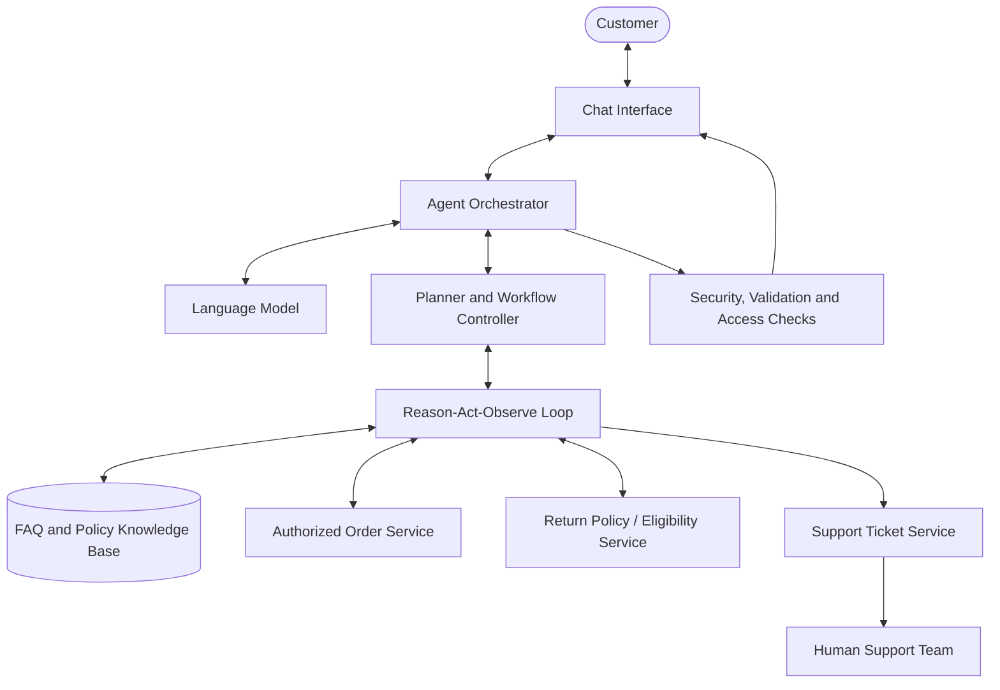
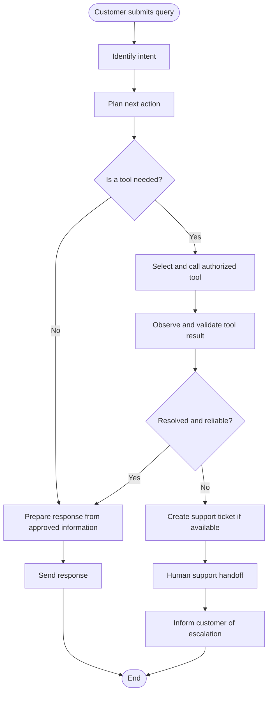

# Day 18 – AI Agent Planning & Architecture Design (ShopEase)

## Overview

Day 18 focuses on the architectural planning and specification of an enterprise **Customer Support AI Agent** for **ShopEase** (a fictional e-commerce platform). 

The design establishes how an autonomous agent handles high-frequency customer enquiries—such as order tracking, FAQs, and return eligibility—by combining a **Reason-Act-Observe (ReAct)** decision cycle with authorized tool integration and safe human support escalation.

---

## Files in this Directory

| File / Folder | Description |
|---|---|
| [`AI_Agent_Planning_Document_ShopEase.md`](AI_Agent_Planning_Document_ShopEase.md) | Comprehensive system design document detailing agent objectives, tool specifications, guardrails, security, and fallback protocols |
| [`Use_Case_Description_CS-01.md`](Use_Case_Description_CS-01.md) | Formal specification for **CS-01: Resolve a Customer Order Enquiry** (actors, preconditions, main flow, exceptions, and data privacy) |
| [`diagrams/architecture_diagram.mmd`](diagrams/architecture_diagram.mmd) | Mermaid source diagram defining component relationships and service boundaries |
| [`diagrams/workflow_diagram.mmd`](diagrams/workflow_diagram.mmd) | Mermaid source diagram mapping the step-by-step query resolution and escalation workflow |

---

## System Architecture

The architecture separates customer communication, orchestration, business tools, and human support handoff:

---

## Agent Decision Workflow

The agent evaluates queries through a structured loop, validating tool outputs before responding or escalating:

---

## Key Design Principles

1. **ReAct Pattern:** Implements iterative reasoning (Think → Act → Observe) to select the right tools and avoid hallucinated facts.
2. **Authorized Tool Grounding:** Integrates dedicated, read-only services for Order Lookup, Return Eligibility, and Policy Knowledge Retrieval.
3. **Graceful Escalation:** When an issue cannot be reliably resolved, the agent automatically creates a support ticket and transfers context to a human agent.
4. **Security & Privacy:** Enforces identity and ownership verification before disclosing sensitive order details or customer PII.
