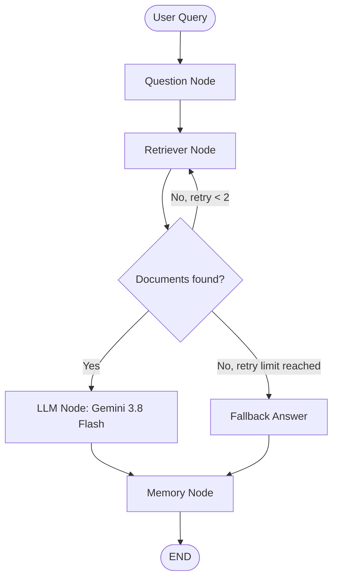

# Day 19 – Workflow Automation with LangGraph & Google Gemini

## Overview

Day 19 focuses on building stateful, resilient AI workflows using **LangGraph** and **Google Gemini (`gemini-3.8-flash`)**. 

The system implements a Question-Answering (QA) agent powered by a shared state graph that features **conditional routing**, **retrieval retry loops**, **graceful fallback handling**, and **conversation memory**.

---

## Directory Files

| File | Description |
|---|---|
| [`main.py`](main.py) | Core Python script implementing the LangGraph state machine, nodes, conditional routing, and Gemini integration |
| [`workflow_analysis.md`](workflow_analysis.md) | Technical report analyzing graph nodes, state transitions, test scenarios, and recovery behaviors |
| [`error_handling_notes.md`](error_handling_notes.md) | Comprehensive notes detailing potential failure modes (API timeouts, missing docs, empty outputs) and mitigations |
| [`langgraph_diagram.md`](langgraph_diagram.md) | Mermaid flowchart and structural documentation of the workflow graph |
| [`.env`](.env) | Configuration file storing the `GEMINI_API_KEY` (kept private) |

---

## Workflow Architecture

The agent executes as a cyclic, directed graph with built-in recovery logic:



---

## Key Features

1. **Shared State (`WorkflowState`):** Uses Python `TypedDict` to track `question`, retrieved `documents`, `answer`, `retry_count`, `memory`, and `llm_error` across all nodes.
2. **Conditional Routing:** Evaluates retrieval results dynamically. If no relevant documents are found, it loops back to retry or routes to a safe fallback response after reaching the retry limit.
3. **Grounded Generation:** Prompts Gemini with retrieved context to minimize hallucinations and strictly prevent generating unsupported facts.
4. **Resilient Error Handling:** Catches API timeouts, missing keys, or empty responses cleanly without terminating the workflow abruptly.
5. **Session Memory:** Retains multi-turn question-and-answer pairs within the workflow state for contextual continuity.

---

## How to Run

1. **Install dependencies:**
   ```bash
   pip install langgraph google-genai python-dotenv
   ```
2. **Configure environment:**
   Create or verify `.env` in `Day 19/`:
   ```env
   GEMINI_API_KEY=your_gemini_api_key_here
   ```
3. **Execute the workflow:**
   ```bash
   python main.py
   ```
