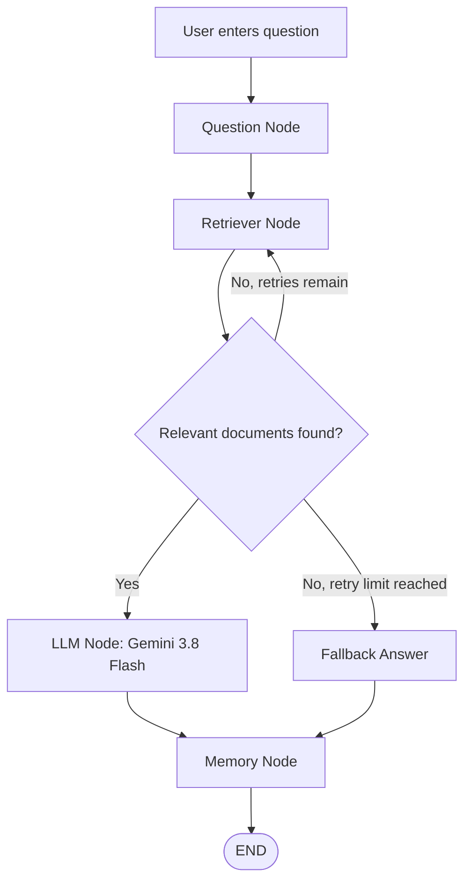

# Day 19 — Updated LangGraph Workflow Diagram

## 1. Workflow Diagram

The diagram represents the implemented question-answering workflow, including conditional retrieval retries and the fallback path.

## 2. Node Descriptions

| Node | Responsibility |
|---|---|
| Question | Receives and stores the user's question. |
| Retriever | Searches the knowledge base and tracks retrieval attempts. |
| LLM | Generates an answer using Gemini when relevant documents are available. |
| Fallback Answer | Returns a message when retrieval fails after the allowed retries. |
| Memory | Stores the question and final response in the workflow's memory list. |

## 3. Conditional Edges

- **Documents found:** Route from the retriever to the LLM node.
- **No documents, retries remaining:** Route back to the retriever.
- **No documents, retry limit reached:** Route to the fallback-answer path.
- **Answer generated or fallback returned:** Route to the memory node, then end the workflow.

## 4. State Used by the Workflow

The shared workflow state contains the question, retrieved documents, answer, retry count, memory list, and LLM error information.

## 5. Diagram Notes

The diagram is a logical representation of the workflow. It highlights the main path and retrieval recovery path; the exact internal edge names and retry-limit configuration should match the implementation in `main.py`.