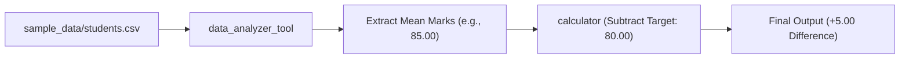

# Day 20 – Function Calling & Modular Tool Execution

## Overview

Day 20 focuses on building a modular **Function Calling & Tool Execution Framework** in Python. The system demonstrates how autonomous workflows and agent systems select, validate, and execute specialized tools using structured schemas and central dispatching.

The architecture includes **8 standalone tools**, a **central dispatcher**, and an automated **chained workflow** that analyzes data and computes performance metrics across tools.

---

## Directory Structure

```text
Day 20/
├── calculator_tool.py          # Arithmetic tool (add, subtract, multiply, divide, modulo)
├── web_search_tool.py          # Web search URL generator and browser launcher
├── database_tool.py            # SQLite database tool for student records
├── file_reader_tool.py         # Text and CSV file reading tool
├── weather_tool.py             # Weather tool (live Open-Meteo API + fallback)
├── email_tool.py               # Email draft composer and validator
├── date_tool.py                # Date arithmetic and formatting tool
├── data_analyzer_tool.py       # CSV dataset summary and statistical analysis
├── tool_dispatcher.py          # Central registry and dynamic function dispatcher
├── workflow_demo.py            # Chained multi-tool workflow (Analyzer -> Calculator)
├── test_tools.py               # Error-handling and edge-case test suite
├── company_data.db             # Local SQLite database for record operations
├── sample_data/
│   └── students.csv            # Sample dataset for workflow demonstration
└── documentation/
    ├── function_calling_documentation.md  # Detailed API specs and signatures
    ├── tool_calling_function_matrix.md   # Schema and parameter mapping matrix
    ├── tool_selection_matrix.md          # Intent-to-tool routing criteria
    └── workflow_notes.md                 # Execution trace and workflow analysis
```

---

## Tool Registry & Summary

All tools return a consistent structured dictionary format (`{"success": bool, ...}`) with descriptive error handling.

| Tool Name | Module | Primary Purpose |
|---|---|---|
| `calculator` | `calculator_tool.py` | Performs basic arithmetic operations with zero-division handling |
| `web_search` | `web_search_tool.py` | Formats search query URLs and optionally opens browser sessions |
| `database` | `database_tool.py` | Executes CRUD operations on local SQLite database (`add`, `view`, `search`) |
| `file_reader` | `file_reader_tool.py` | Reads and validates local text and CSV file contents |
| `weather` | `weather_tool.py` | Retrieves current temperature and conditions (API with fallback) |
| `email` | `email_tool.py` | Validates recipient addresses and prepares structured email drafts |
| `date` | `date_tool.py` | Calculates date differences, adds offsets, and formats timestamps |
| `data_analyzer` | `data_analyzer_tool.py` | Computes statistical summaries (mean, median, min, max, null counts) |

---

## Chained Workflow: Student Analysis

[`workflow_demo.py`](workflow_demo.py) demonstrates multi-tool chaining:



1. **Step 1:** The **Data Analyzer** reads `sample_data/students.csv` and calculates column statistics.
2. **Step 2:** The workflow extracts the mean mark from the analysis result.
3. **Step 3:** The **Calculator** computes the difference between the actual average and target score (`80.0`).
4. **Step 4:** The workflow evaluates whether the target was met or exceeded.

---

## How to Run

1. **Execute the Central Tool Dispatcher:**
   ```bash
   python tool_dispatcher.py
   ```
2. **Run the Chained Workflow Demonstration:**
   ```bash
   python workflow_demo.py
   ```
3. **Run Error & Edge-Case Tests:**
   ```bash
   python test_tools.py
   ```
