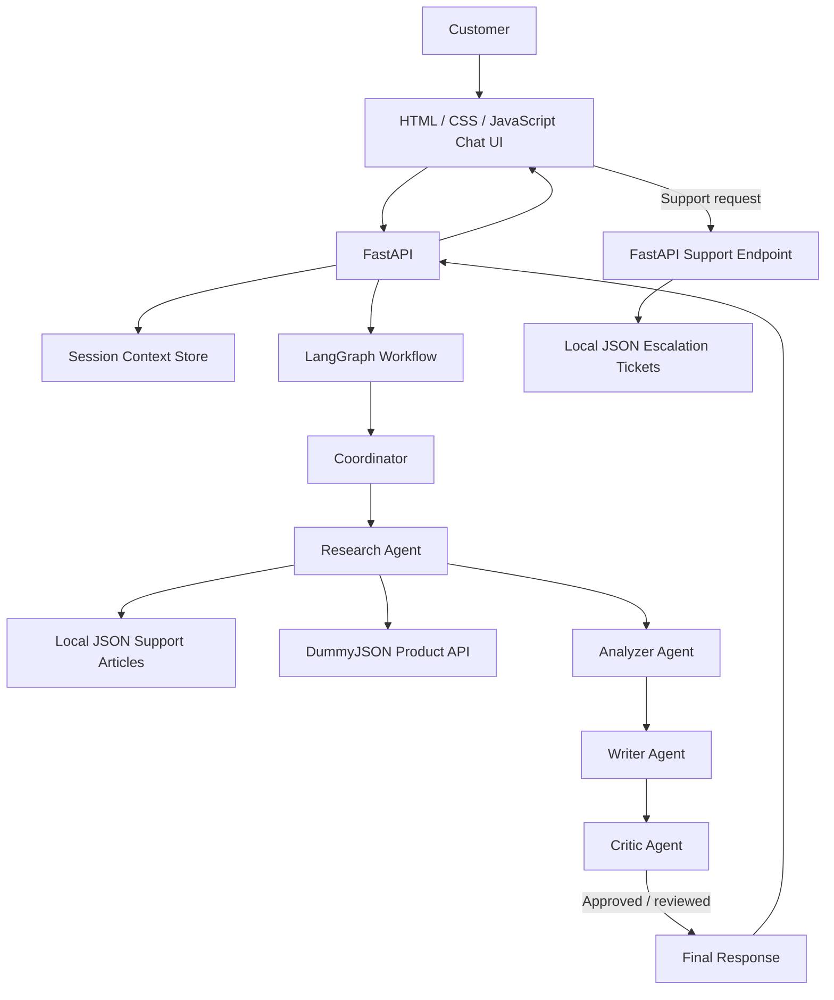

# ShopEase Architecture

## Component overview

## Request flow

1. **Frontend:** Sends the customer's message and the current `session_id`.
2. **FastAPI:** Retrieves recent messages from the in-memory session store.
3. **Coordinator:** Resolves simple follow-up references using the most recent customer question.
4. **Research Agent:**
   - Searches `data/knowledge_base.json` for support guidance.
   - Calls the DummyJSON product search endpoint only when the query appears to concern a product.
5. **Analyzer Agent:** Collects retrieved information, sets a confidence label, identifies the query category and decides whether the available information is sufficient.
6. **Writer Agent:** Produces a response using the retrieved support articles and/or catalogue results.
7. **Critic Agent:** Checks the response and can route it through one revision.
8. **FastAPI:** Returns the answer, source titles, product results, category and session ID.
9. **Escalation:** The support form posts a request to `/support`; the API writes a pending demo ticket to `data/escalations.json`.

## Main boundaries

- **Local data:** Support articles and escalation tickets.
- **External data:** Product catalogue results from DummyJSON.
- **Temporary state:** Conversation history held in memory per session.
- **Workflow orchestration:** LangGraph connects the agents; individual agent responsibilities remain in `agents.py`.

## Demo limitations

This is a functional academic demonstration, not a production commerce platform. DummyJSON provides mock catalogue data; support tickets are locally recorded and are not routed to real staff; session history is lost when the server restarts. The agents use deterministic Python logic and do not call a large language model.
